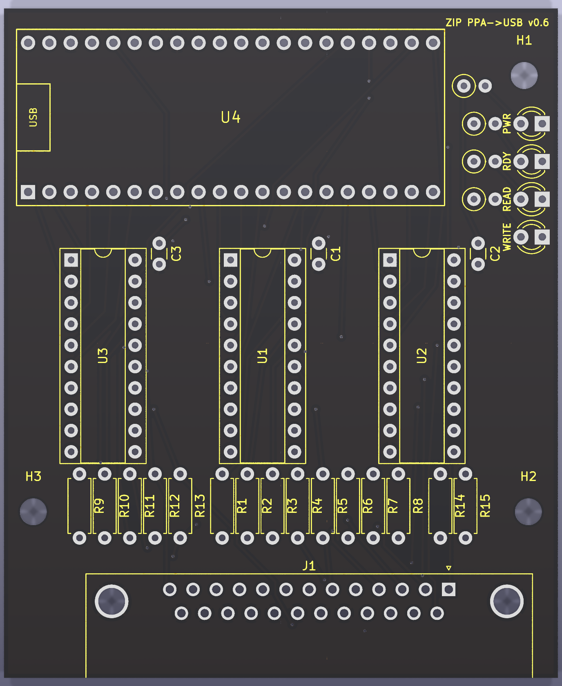
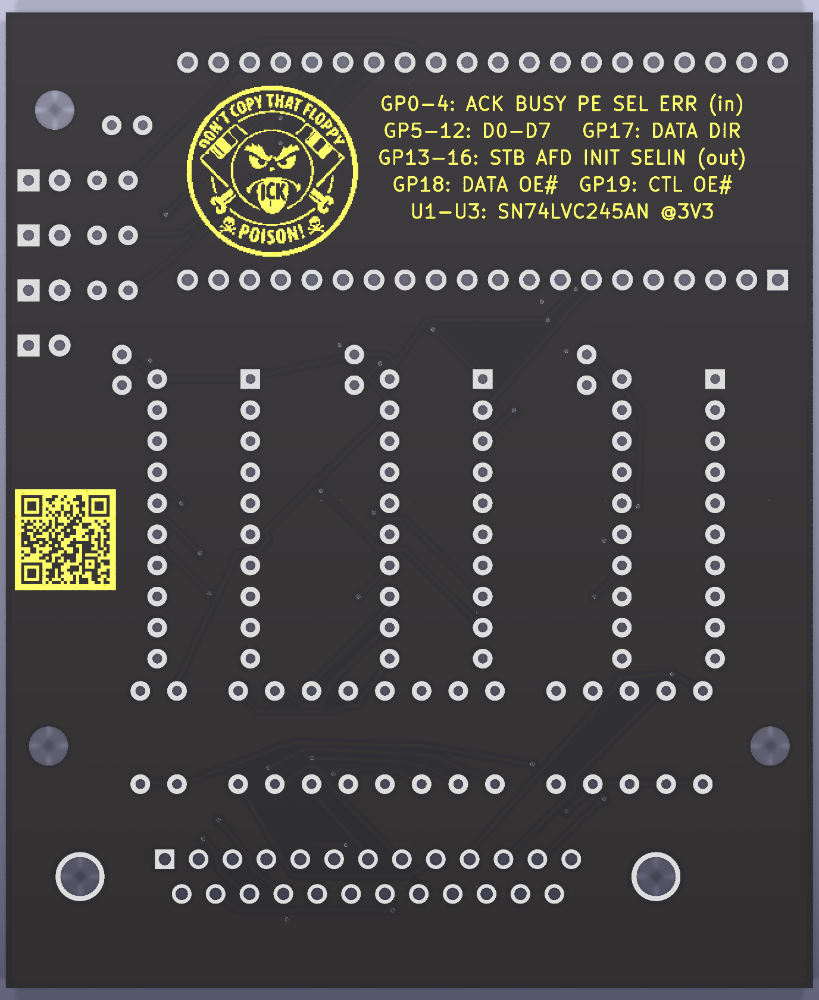
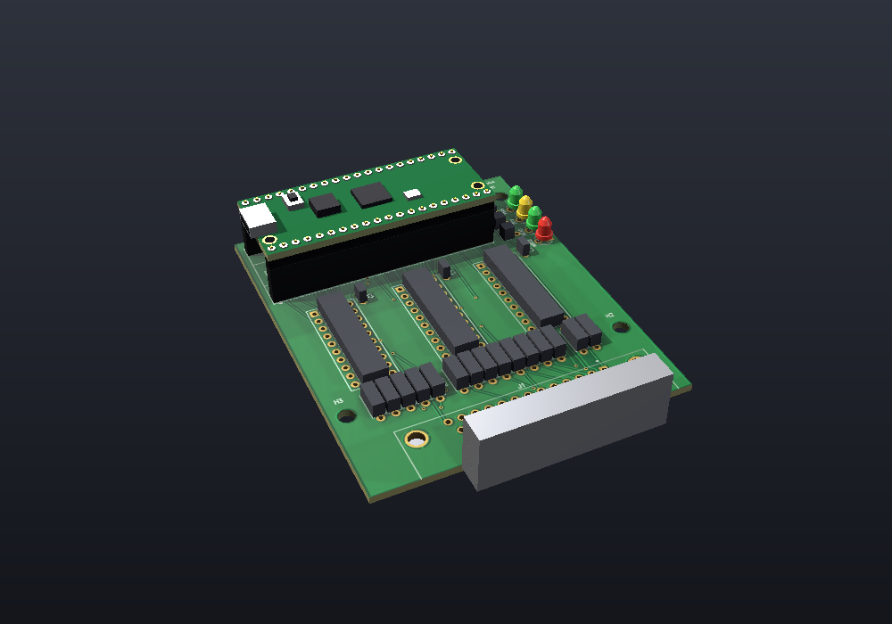

# Zip Drive Adapter

This adapter lets you plug a **parallel-port Iomega Zip 100** into a modern computer over USB. A Raspberry Pi Pico 2 (RP2350) speaks the Zip's PPA protocol on the parallel side, and the computer sees a USB mass-storage device.

 <a href="https://retrorecoveryrestore.com/">retrorecoveryrestore.com</a>

## Board (v0.6)

  
  &nbsp;
  

KiCad 3D renders of the bare board in the ordered colours (black solder mask, yellow silkscreen). Top on the left, bottom on the right.

Assembled preview from PCBPA's 3D view (its default green and white colours), showing the Pico 2 on its headers, the status LEDs and the DB25.

## Status
- **Board v0.6**: ordered from PCBWay on 2026-11-25, due 2026-12-01. Not yet built or tested. KiCad DRC is clean, and so are PCBPA's checks under PCBWay's standard rules.
- **Firmware**: not started. The plan is in [CLAUDE.md](CLAUDE.md).

## ⚠️ Parallel-port devices only
DB25 is just the connector shape, and several incompatible interfaces use it. This board is a **parallel-port (IEEE 1284) host**: 8 bidirectional data lines, 4 control outputs and 5 status inputs, with ground on pins 18–25.

| DB25 device | OK to connect? |
|---|---|
| **Parallel-port devices**: Zip 100 parallel, printers, parallel scanners and drives | ✅ The hardware is compatible. Each device needs its own firmware; the Zip 100 (PPA protocol) is the target. Zip Plus and Zip 250 parallel use a different protocol (IMM). |
| **RS-232 serial on DB25**: modems, terminals | ❌ **Can damage the board.** Serial uses about ±12V, and the 74LVC245 buffers only tolerate roughly −0.5V to 6.5V. |
| **SCSI on DB25**: Mac-style SCSI, *including the SCSI Zip 100* | ❌ **Don't plug it in.** The pinout is completely different, and SCSI puts +5V termination power on pin 25, which this board ties to ground. |

**Check your Zip before you connect it.** The SCSI Zip 100 uses the same DB25 connector as the parallel one. The SCSI model has two DB25 ports plus SCSI ID and termination switches on the back. The parallel model has a single DB25 and is labelled as a parallel-port drive.

## Ordering from PCBWay (v0.6)
**Step-by-step guide: [ORDERING.md](ORDERING.md)**, covering every field on PCBWay's quote form, the Gerber upload and the review.

Upload `zipbridge_v0.6_gerbers.zip`, or take it from the [v0.6 release](../../releases/tag/v0.6).

| Option | Value |
|---|---|
| Layers | 2 |
| Size | 66 × 79.8 mm |
| Thickness | 1.6 mm |
| Min track / spacing | 0.25 / 0.2 mm (6/6 mil or better is fine) |
| Min hole | 0.3 mm |
| Surface finish | HASL |
| **Solder mask** | **Black** |
| **Silkscreen** | **Yellow** |

Both are standard PCBWay options. The bottom-side artwork is drawn for light ink on a dark mask. The Ick logo prints in yellow on black, like the sticker. The QR code prints its light background in yellow, and the black board shows through as the modules (normal QR polarity). With a light mask and dark silkscreen, both would come out inverted.

## Bill of Materials
Every part is through-hole. The same list is in [BOM.md](BOM.md), with more notes and a [where-to-buy table](BOM.md#where-to-buy), and as a spreadsheet in [BOM.csv](BOM.csv).

| Qty | Refs | Part | Value / spec | Notes |
|---:|---|---|---|---|
| 1 | U4 | Raspberry Pi Pico 2 (RP2350) | — | Component side up, USB at the left edge · [Amazon](https://www.amazon.com/dp/B0DG3QPQCT) |
| 3 | U1–U3 | SN74LVC245AN | DIP-20 transceiver | U1 data, U2 control, U3 status. Must be **LVC** (3.3V, 5V-tolerant inputs) · buy from [DigiKey](https://www.digikey.com/en/products/result?keywords=SN74LVC245AN) or [Mouser](https://www.mouser.com/c/?q=SN74LVC245AN), not Amazon |
| 1 | J1 | DB25 female, right-angle, PCB mount | 0.318" setback, board locks | [Amazon B00C58IPSO](https://www.amazon.com/dp/B00C58IPSO) (bought) · alt. [McMaster 5063N19](https://www.mcmaster.com/5063N19) |
| 8 | R1–R8 | Resistor | 100Ω ¼W | Data-line series · [resistor kit](https://www.amazon.com/dp/B07P3MFG5D) (covers all resistors) |
| 7 | R9–R15 | Resistor | 10kΩ ¼W | Status and OE# pull-ups |
| 4 | R16–R19 | Resistor | 470Ω ¼W, **standing**, 2.54mm | LED series |
| 3 | C1–C3 | Ceramic capacitor | 100nF 50V, 2.5mm | Decoupling · [Amazon](https://www.amazon.com/dp/B0DFQ93CPT) |
| 1 | D1 | LED 3mm | Green | **PWR** (3.3V) · [LED kit](https://www.amazon.com/dp/B07CB44M2Z) (covers D1–D4) |
| 1 | D2 | LED 3mm | Yellow | **READY** (GP22) |
| 1 | D3 | LED 3mm | Green | **READ**, Zip→PC (GP20) |
| 1 | D4 | LED 3mm | Red | **WRITE**, PC→Zip (GP21) |
| 3 | — | DIP-20 IC socket, 0.3" | — | For U1–U3 · [Amazon](https://www.amazon.com/dp/B07H3RPFH8) |
| 2 | — | 1×20 female header, 2.54mm | — | Optional: removable Pico · [Amazon](https://www.amazon.com/dp/B0CFDV41T9) |
| 3 | — | M3 standoff + screw | — | Optional: mounting holes H1–H3 · [Amazon](https://www.amazon.com/dp/B0F297R23T) |
| 1 | — | PCB | v0.6, black mask / yellow silk | See [ORDERING.md](ORDERING.md) |

You also need the Zip's original DB25 male–male cable, a micro-USB cable, and the Zip's own power supply. Use red, green or yellow LEDs; blue and white are too dim at 3.3V. The GPIO map is in [CLAUDE.md](CLAUDE.md#gpio-map).

**Status LEDs** are on the right edge. PWR is lit whenever the board has 3.3V. READY, READ and WRITE are driven by the firmware.

**Footprints:** the Pico 2 and DB25 footprints match KiCad's reference footprints exactly. From v0.4 on, the board edge is placed so the 0.318" DB25's flange sits flush.

## Files
| File | What it is |
|---|---|
| `zipbridge_vX.Y.kicad_pcb` | Board (KiCad) |
| `zipbridge_vX.Y.pcbpa` | The same board in PCBPA |
| `zipbridge_vX.Y_gerbers.zip` | Fab files |
| `build.py`, `router.py`, `pour.py` | Board generator: place → route → pour |
| `BOM.md`, `BOM.csv` | Bill of materials |
| `ORDERING.md` | How to order the PCB from PCBWay |
| `models/` | 3D model (STL) of the DB25, used by the `.pcbpa` board's 3D view. Made from KiCad's model by `art/wrl_to_stl.py` |
| `firmware/` | Bring-up firmware for the Pico 2: USB serial console to test every LED, buffer and DB25 signal without a Zip drive. Checklist in `firmware/BRINGUP.md` |
| `images/` | Board renders |
| `art/` | Logo and QR source images, plus `add_artwork.py`, which puts them on the bottom silkscreen |
